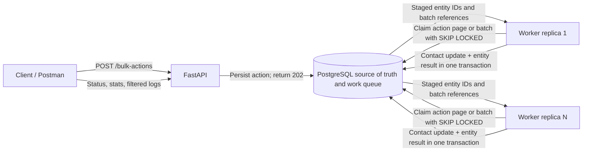

# Architecture and implementation decisions

## Components

## Why PostgreSQL is the queue

The assignment needs a competing-consumer work queue: one batch should be claimed by one worker at a time. PostgreSQL row locks with `SKIP LOCKED` provide durable claims and horizontal worker distribution without adding a second broker or maintaining queue state outside the source of truth. Queue rows contain action and batch references; entity IDs are persisted in `bulk_action_logs`, not sent in queue messages.

For a deployment with much higher enqueue volume or independent event consumers, the batch table can be replaced or fronted by a broker. The processor registry and persisted action/batch contracts keep that transport change separate from entity-specific behavior.

PostgreSQL is required in every environment. Workers coordinate through PostgreSQL row locks and `SKIP LOCKED`, so multiple worker processes can safely claim independent work. Configure the local PostgreSQL connection with `DATABASE_URL`; SQLite is not a supported runtime.

## Selection and batching

The API only validates and inserts a `QUEUED` action. A worker claims it and keyset-pages through matching contacts using `id > cursor`, bounded by `SELECTION_PAGE_SIZE`. Each page is split into `BATCH_SIZE` batches. The action stores the last selected ID, so a crashed selector can resume without loading the full data set or duplicating staged results. The unique `(action_id, entity_id)` constraint adds a second idempotency guard.

Selection is staged incrementally. While selection is in progress, `total` is the number selected so far and progress is based on the staged records; `selection_complete` is internal and terminal status is set only after all batches have stopped. An entity is rechecked against the original filter at execution time. If it no longer matches, its result is `SKIPPED`.

## Persistence model

| Table | Purpose |
| --- | --- |
| `contacts` | Initial CRM entity, indexed by account, status, and email |
| `bulk_actions` | Request payload, lifecycle, running selection cursor, and totals |
| `bulk_action_batches` | Durable work units, lease owner, retry count, and batch state |
| `bulk_action_logs` | Unique per-action entity result, attempts, error, and completion time |
| `account_rate_windows` | One locked UTC-minute event reservation counter per account |

## Processing, idempotency, and failure behavior

Workers claim a batch using a short transaction and a lease. The batch transaction locks its pending logs and contacts, applies updates, writes `SUCCESS`, `FAILED`, or `SKIPPED`, then marks the batch complete. Contact updates and their result logs commit together. If the transaction fails or the worker dies before commit, both roll back; after the lease expires, another worker can safely retry. If commit succeeds but the worker loses its response, the next attempt sees no pending logs and completes the batch without repeating changes.

Before processing, a worker reserves the batch's entity count against a PostgreSQL fixed window for that account. The `account_rate_windows` row is locked while reserving, so all worker replicas share the 10,000-events-per-UTC-minute limit. A batch that does not fit is deferred to the next minute without consuming a retry attempt. `GET /accounts/{accountId}/rate-limit` reports the current window, reserved count, and remaining capacity. Reservations are conservative: an infrastructure crash after reservation can consume capacity even if that batch needs a retry.

Accounts are first-class PostgreSQL rows. Contacts, actions, rate windows, and result logs reference their owning account; composite result-log foreign keys additionally enforce that its action, batch, and contact belong together. A worker is a process, not an account-specific service. Every worker polls the same durable queue, so jobs from multiple accounts can be handled concurrently by different processes. Per-account rate windows remain shared across those workers.

An optional `scheduled_at` on a bulk action gates both target selection and batch claims. Future actions remain `SCHEDULED`; workers only claim them after the timezone-aware timestamp is due. Contact processing checks account-scoped, trimmed, case-insensitive email duplicates once per batch. The lowest contact ID is the canonical row; other duplicate rows are written to the ordinary action result ledger as `SKIPPED` with the canonical ID in the reason.

Each claimed batch stores the worker ID, and workers log result counts after commit. `GET /bulk-actions/{actionId}/batches` exposes batch-level state and ownership. The `app.verify_action` command checks that log counts match batch sizes and successful Contact rows contain the requested updates.

Record-level errors are terminal for that attempt and do not stop the batch. Infrastructure exceptions return the batch to the queue with exponential backoff; after the configured retry limit it is marked `FAILED`. Pending entities remain `PENDING` when infrastructure retries are exhausted. The retry endpoint requeues pending work from failed batches and failed records from completed batches while preserving successful logs.

Action status becomes `FAILED` only when at least one batch exhausts infrastructure retries. If all batches finish, the action is `COMPLETED` even when some individual contacts failed; those results remain visible in statistics and logs. This separates a completed run with record-level errors from an action that could not finish its queued work.

## Extending the platform

The shared engine has no Contact model dependency. Processor modules are discovered from `app/processors` at startup and register an `(entity, action)` handler. A handler implements the bounded selection query and stable key, locked entity loading, account-scope and filter checks, input validation, and the operation itself. The engine continues to own page staging, durable batches, PostgreSQL claims, leases, transactions, result logs, retries, and statistics.

To add an integer-keyed CRM entity or action, add its model and a processor module under `app/processors`; the module registers itself with the shared registry. No worker-loop or batch-engine changes are needed. `operationData` is the generic API payload name; `updates` remains accepted as a compatibility alias for the initial Contact update request. `bulk_action_logs.entity_id` is currently a `BIGINT`, so entities with non-integer keys would require changing that persistence contract. The current processor is `contact/update`.

For a repeatable worker-loss demo, submit an action while no healthy workers are running, then run `python -m app.simulate_worker_failure --lease-seconds 10`. This helper stages a page, claims one batch, shortens that batch's lease for the demo, and exits with code 91 before processing it. Start healthy workers afterward; PostgreSQL makes the abandoned batch available after the lease expires.

## Scaling and operational limits

Run multiple `worker` replicas (`docker compose up --scale worker=4`). Each replica claims work dynamically; no batch is assigned permanently to a worker. PostgreSQL connection capacity and indexes should be tuned for the number of replicas and workload. The included measurement script captures actual throughput for a seeded workload; deployment performance should be based on those measurements rather than estimated values.
