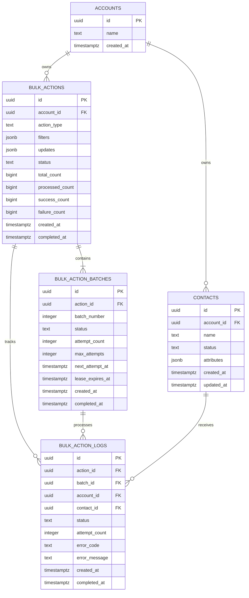

# Database Implementation: Bulk Action Assignment

**Status:** Runtime implementation notes plus reference design  
**Database:** PostgreSQL  
**Related documents:** [Product requirements](prd.md), [architecture diagram](architecture_diagram.png)  
**Last updated:** 2026-10-10

> **Implementation alignment:** The reference architecture below discusses Redis as a dispatch queue. The current runnable implementation does not use Redis: PostgreSQL `bulk_action_batches` rows are the durable queue, claimed by workers using `FOR UPDATE SKIP LOCKED`. CSV is only for initial seeding; bulk jobs are submitted through the API. Treat Redis-specific publication/reconciliation notes below as a future alternative, not a prerequisite for running this project.

> **Current schema differences:** Runtime account IDs are `VARCHAR(100)` (for example, `A001`) and contact/entity IDs are generated `BIGINT`s. Runtime now has an `accounts` parent table, account foreign keys on contacts and actions, and `account_id` on each result log. Composite log foreign keys bind a result to the same account, action, batch, and contact. `bulk_actions.scheduled_at` stores an optional timezone-aware start time. The SQL below is a design baseline and has not been rewritten to match every runtime type name.

### Runtime account, duplicate, and schedule behavior

- Create an account with `POST /accounts`, then add contacts using `POST /accounts/{accountId}/contacts` or `python -m app.seed --account-id <id>`. The account can own any number of contacts; the API accepts contact inserts in chunks of up to 5,000.
- Duplicate contact emails are detected within the same account after trimming whitespace and comparing case-insensitively. When a bulk action selects duplicates, the lowest contact ID is the canonical record; later duplicate records are not updated and receive a `SKIPPED` result log with the duplicate email and canonical contact ID. Different accounts may use the same email.
- Submit `scheduledAt` as an ISO 8601 datetime with an explicit timezone, for example `2026-11-22T23:15:00+05:30`. Actions scheduled in the future remain `SCHEDULED`; the shared workers start selection and execution only when the due time arrives.
- Every `python -m app.worker` process is one worker. Workers do not belong to a specific account: all workers claim due actions and queued batches across all accounts from PostgreSQL. `FOR UPDATE SKIP LOCKED` lets them take separate rows concurrently. Local dashboard scaling can start several processes, bounded by `MAX_LOCAL_WORKERS`; production scaling is controlled by the deployment platform.
- The configured 10,000 events/minute limit is account-scoped and shared by all workers and actions for that account. It is independent of worker count.

## 1. Purpose and scope

This document turns the supplied schema plan into an implementation design for API-triggered bulk actions. CSV is an initial data-seeding mechanism only. A bulk action is submitted through the API with an action, parameters, and a target specification; it does not consume a CSV upload.

PostgreSQL is the durable source of truth and queue for accounts, contacts, jobs, batches, and per-contact outcomes. The design keeps the plan's five core tables: `accounts`, `contacts`, `bulk_actions`, `bulk_action_batches`, and `bulk_action_logs`.

In this design, `bulk_action_logs` is the per-contact work ledger: it records the selected contact, its assigned batch, its processing state, and its final outcome. It is not an append-only record of every retry attempt. Batch-level attempt metadata and the last error are stored on `bulk_action_batches`. If a full immutable attempt audit is required, add a separate attempt-history table in a later schema revision.

## 2. Entity relationship diagram



Each `bulk_action_logs` row connects one job, one batch, and one contact. Composite foreign keys in the DDL enforce that the batch belongs to the same job and that the contact belongs to the same account as the job. This prevents accidental cross-account work even if application filtering has a defect.

## 3. Table responsibilities

| Table | One row represents | Why it exists |
|---|---|---|
| `accounts` | One CRM tenant/customer | Defines ownership and the isolation boundary. It is not a login-user table. |
| `contacts` | One CRM contact | Stores the source-of-truth business record that actions modify. Seeded CSV data is imported here. |
| `bulk_actions` | One API-submitted bulk job | Persists the request, tenant, target-selection rule, lifecycle, and cached progress for status APIs. |
| `bulk_action_batches` | One dispatchable unit of a job | Enables independent worker claims, progress, retries, and recovery. |
| `bulk_action_logs` | One targeted contact in one job | Materializes the job's target set and tracks that contact's pending/running/terminal outcome. Supports result listing and safe recovery. |

### Why materialize target contacts?

The job's filter describes how targets were selected, but contacts can change after submission. The work ledger captures the exact contact IDs selected for this job, their batch assignments, and their outcomes. This makes `total_count` stable and prevents later changes to contact status from silently changing the meaning of an already-accepted job.

## 4. Proposed PostgreSQL schema

The following DDL is a reference baseline. Confirm contact fields, action vocabulary, and production sizing before adopting it as a migration. It uses checks instead of PostgreSQL enum types so statuses can evolve through ordinary migrations.

```sql
CREATE TABLE accounts (
    id          uuid PRIMARY KEY DEFAULT gen_random_uuid(),
    name        text NOT NULL,
    created_at  timestamptz NOT NULL DEFAULT now(),
    CONSTRAINT accounts_name_not_blank CHECK (length(trim(name)) > 0),
    CONSTRAINT accounts_id_id_key UNIQUE (id)
);

CREATE TABLE contacts (
    id          uuid PRIMARY KEY DEFAULT gen_random_uuid(),
    account_id  uuid NOT NULL REFERENCES accounts(id) ON DELETE RESTRICT,
    name        text NOT NULL,
    status      text NOT NULL,
    attributes  jsonb NOT NULL DEFAULT '{}'::jsonb,
    created_at  timestamptz NOT NULL DEFAULT now(),
    updated_at  timestamptz NOT NULL DEFAULT now(),
    CONSTRAINT contacts_id_account_id_key UNIQUE (id, account_id),
    CONSTRAINT contacts_name_not_blank CHECK (length(trim(name)) > 0),
    CONSTRAINT contacts_status_not_blank CHECK (length(trim(status)) > 0),
    CONSTRAINT contacts_attributes_object CHECK (jsonb_typeof(attributes) = 'object')
);

CREATE TABLE bulk_actions (
    id              uuid PRIMARY KEY DEFAULT gen_random_uuid(),
    account_id      uuid NOT NULL REFERENCES accounts(id) ON DELETE RESTRICT,
    action_type     text NOT NULL,
    filters         jsonb NOT NULL DEFAULT '{}'::jsonb,
    updates         jsonb NOT NULL,
    status          text NOT NULL DEFAULT 'ACCEPTED',
    total_count     bigint NOT NULL DEFAULT 0,
    processed_count bigint NOT NULL DEFAULT 0,
    success_count   bigint NOT NULL DEFAULT 0,
    failure_count   bigint NOT NULL DEFAULT 0,
    created_at      timestamptz NOT NULL DEFAULT now(),
    started_at      timestamptz,
    completed_at    timestamptz,
    CONSTRAINT bulk_actions_id_account_id_key UNIQUE (id, account_id),
    CONSTRAINT bulk_actions_type_not_blank CHECK (length(trim(action_type)) > 0),
    CONSTRAINT bulk_actions_status_check CHECK (
        status IN ('ACCEPTED', 'QUEUED', 'RUNNING', 'CANCELLING', 'COMPLETED',
                   'COMPLETED_WITH_ERRORS', 'FAILED', 'CANCELLED')
    ),
    CONSTRAINT bulk_actions_filters_object CHECK (jsonb_typeof(filters) = 'object'),
    CONSTRAINT bulk_actions_updates_object CHECK (jsonb_typeof(updates) = 'object'),
    CONSTRAINT bulk_actions_counts_nonnegative CHECK (
        total_count >= 0 AND processed_count >= 0 AND success_count >= 0 AND failure_count >= 0
    ),
    CONSTRAINT bulk_actions_count_consistency CHECK (
        processed_count = success_count + failure_count
        AND processed_count <= total_count
    )
);

CREATE TABLE bulk_action_batches (
    id               uuid PRIMARY KEY DEFAULT gen_random_uuid(),
    action_id        uuid NOT NULL REFERENCES bulk_actions(id) ON DELETE RESTRICT,
    batch_number     integer NOT NULL,
    status           text NOT NULL DEFAULT 'QUEUED',
    attempt_count    integer NOT NULL DEFAULT 0,
    max_attempts     integer NOT NULL DEFAULT 5,
    next_attempt_at  timestamptz NOT NULL DEFAULT now(),
    lease_expires_at timestamptz,
    worker_id        text,
    last_error_code  text,
    last_error       text,
    created_at       timestamptz NOT NULL DEFAULT now(),
    started_at       timestamptz,
    completed_at     timestamptz,
    CONSTRAINT bulk_action_batches_action_batch_number_key UNIQUE (action_id, batch_number),
    CONSTRAINT bulk_action_batches_id_action_id_key UNIQUE (id, action_id),
    CONSTRAINT bulk_action_batches_status_check CHECK (
        status IN ('QUEUED', 'RUNNING', 'RETRY_WAIT', 'COMPLETED', 'FAILED', 'CANCELLED')
    ),
    CONSTRAINT bulk_action_batches_batch_number_positive CHECK (batch_number > 0),
    CONSTRAINT bulk_action_batches_attempts_check CHECK (
        attempt_count >= 0 AND max_attempts > 0 AND attempt_count <= max_attempts
    )
);

CREATE TABLE bulk_action_logs (
    id              uuid PRIMARY KEY DEFAULT gen_random_uuid(),
    action_id       uuid NOT NULL,
    batch_id        uuid NOT NULL,
    account_id      uuid NOT NULL,
    contact_id      uuid NOT NULL,
    status          text NOT NULL DEFAULT 'PENDING',
    attempt_count   integer NOT NULL DEFAULT 0,
    error_code      text,
    error_message   text,
    created_at      timestamptz NOT NULL DEFAULT now(),
    started_at      timestamptz,
    completed_at    timestamptz,
    CONSTRAINT bulk_action_logs_action_contact_key UNIQUE (action_id, contact_id),
    CONSTRAINT bulk_action_logs_action_fk
        FOREIGN KEY (action_id, account_id)
        REFERENCES bulk_actions(id, account_id) ON DELETE RESTRICT,
    CONSTRAINT bulk_action_logs_batch_fk
        FOREIGN KEY (batch_id, action_id)
        REFERENCES bulk_action_batches(id, action_id) ON DELETE RESTRICT,
    CONSTRAINT bulk_action_logs_contact_fk
        FOREIGN KEY (contact_id, account_id)
        REFERENCES contacts(id, account_id) ON DELETE RESTRICT,
    CONSTRAINT bulk_action_logs_status_check CHECK (
        status IN ('PENDING', 'RUNNING', 'SUCCESS', 'FAILED', 'CANCELLED')
    ),
    CONSTRAINT bulk_action_logs_attempt_count_nonnegative CHECK (attempt_count >= 0)
);
```

`gen_random_uuid()` is available in supported modern PostgreSQL versions; confirm the deployment version and extension/function availability. The repeated `UNIQUE (id, ...)` keys support the composite foreign keys that enforce tenant and parent consistency.

## 5. Indexes

Add indexes for the API and worker access patterns. Validate these against real query plans and data volume; indexes increase write cost.

```sql
-- Tenant-scoped contact filter and list operations.
CREATE INDEX contacts_account_status_id_idx
    ON contacts (account_id, status, id);
CREATE INDEX contacts_attributes_gin_idx
    ON contacts USING gin (attributes jsonb_path_ops);

-- Account job history and operational scans.
CREATE INDEX bulk_actions_account_created_idx
    ON bulk_actions (account_id, created_at DESC);
CREATE INDEX bulk_actions_active_idx
    ON bulk_actions (created_at)
    WHERE status IN ('ACCEPTED', 'QUEUED', 'RUNNING', 'CANCELLING');

-- Recovery/dispatch query for available and expired batches.
CREATE INDEX bulk_action_batches_dispatch_idx
    ON bulk_action_batches (next_attempt_at, created_at)
    WHERE status IN ('QUEUED', 'RETRY_WAIT');
CREATE INDEX bulk_action_batches_expired_lease_idx
    ON bulk_action_batches (lease_expires_at)
    WHERE status = 'RUNNING';

-- Per-job results and pending item claiming.
CREATE INDEX bulk_action_logs_job_status_idx
    ON bulk_action_logs (action_id, status, id);
CREATE INDEX bulk_action_logs_batch_status_idx
    ON bulk_action_logs (batch_id, status, id);
```

Do not assume a GIN index on arbitrary `attributes` makes arbitrary filters safe or fast. Expose a documented, allow-listed filter grammar and add targeted indexes for the fields the API actually supports. Never interpolate client-supplied field names into SQL without validation/allow-listing.

## 6. Relationships and cardinality

- One account owns zero or more contacts.
- One account owns zero or more bulk action jobs.
- One job has one or more batches once target work has been resolved. A valid request with zero matching contacts should finish as a no-op without creating invalid zero-work batches; its terminal status and `total_count = 0` behavior must be documented.
- One job has zero or more per-contact ledger rows. For a non-empty accepted job, each target contact has exactly one ledger row due to `UNIQUE (action_id, contact_id)`.
- One batch has zero or more ledger rows. The batch's ledger rows must all refer to the same parent job.
- One contact can appear in many jobs over time, but at most once in any single job.

## 7. Request acceptance and target snapshot

The action-start endpoint accepts an API payload conceptually like:

```json
{
  "action_type": "BULK_UPDATE",
  "filters": {"status": "NEW"},
  "updates": {"status": "ACTIVE"}
}
```

The service derives `account_id` from authenticated context; it must not trust a tenant ID in the request body as authorization. Validate action type, filter operators/fields, updateable fields, value types, and tenant scope before accepting.

Recommended durable flow:

1. In a PostgreSQL transaction, insert `bulk_actions` with `ACCEPTED` and the validated request.
2. Resolve matching contacts scoped by `account_id` and materialize one `bulk_action_logs` row per target. This creates the stable work manifest. Do not load the complete target set into application memory.
3. Assign pending ledger rows to batches in bounded chunks. Use deterministic keyset/chunk selection; avoid `OFFSET` over a changing dataset. `batch_number` is unique within a job.
4. Set `total_count` to the number of materialized ledger rows and commit the durable job, work ledger, batch rows, and updated status together.
5. Publish batch IDs to Redis only after commit. Prefer a transactional outbox if reliable publication is required: without one, a process can crash after commit but before enqueue. With the current five-table constraint, a dispatcher/reconciler can scan PostgreSQL for queued batches not yet dispatched, but this may cause duplicate delivery and therefore requires idempotent workers.
6. Return `202 Accepted` and the job ID when the API has durably accepted the job. If target materialization is too expensive for request latency, persist an accepted job and let a resolver stage select/partition targets asynchronously; expose `RESOLVING` or equivalent status if that phase is used.

The product must decide whether “targets” mean contacts matching filters at request acceptance or when a background resolver runs. The former gives stronger submission-time snapshot semantics; the latter allows large jobs to be accepted faster but can include later data changes. Document and consistently implement the selected rule.

## 8. Worker, progress, and retry behavior

### Claiming work

Workers should claim eligible batches atomically with `SELECT ... FOR UPDATE SKIP LOCKED`, transition them to `RUNNING`, increment `attempt_count`, and set `worker_id` plus a lease expiry. Keep the claim transaction short; do not hold row locks while doing long-running work. A lease lets recovery identify a worker that stopped heartbeating or crashed.

### Applying actions

For contact updates stored in the same PostgreSQL database, execute each contact's update and its ledger outcome in one transaction where practical. Scope every update by both `contact_id` and `account_id`. A batch can contain multiple per-contact transactions so that one bad record does not erase successful updates for the rest of the batch. Action handlers must be idempotent because queue delivery is at least once and a worker may crash around commit/ack boundaries.

For effects outside PostgreSQL, a database transaction cannot make the remote effect and local result atomic. Use an idempotency key at the downstream boundary or document the resulting delivery semantics.

### Outcome and progress

- `SUCCESS`, `FAILED`, and `CANCELLED` are terminal ledger states; `PENDING` and `RUNNING` are not terminal.
- `processed_count` is the number of terminal success plus terminal failure rows; decide whether cancelled rows contribute to a separate count or `processed_count` and apply consistently. The DDL baseline assumes only success/failure contribute to `processed_count`.
- `total_count` is the materialized target count and should not change after execution starts.
- Cached job counters must be updated atomically (for example, conditional state transition plus counter delta in one transaction) or derived from ledger aggregates. Do not let workers read-modify-write counters in application memory.
- A batch is `COMPLETED` when all its ledger rows are terminal and no unresolved failure requires retry. It is `RETRY_WAIT` when policy permits another attempt. It is `FAILED` when retry attempts are exhausted or the failure is permanent.
- A job is `COMPLETED` when every target succeeded, `COMPLETED_WITH_ERRORS` when processing ended with failures, and `FAILED` for a defined job-level fatal condition. Define cancellation precedence for already successful and in-flight rows.

The `bulk_action_logs` table stores the latest per-contact state and latest error. If every individual retry/error event must be queryable, add `bulk_action_attempts` with a foreign key to the ledger row, attempt number, outcome, error, and timestamps; do not overload the outcome ledger into an ambiguous append-only log.

## 9. Data lifecycle and tenant isolation

- Derive tenant scope from authenticated server-side context for every action, contact, and result query.
- Keep the composite foreign keys in place; application-level filters alone are insufficient protection from mismatched references.
- Restrict contact/job deletion while work or result history refers to those records. The baseline uses `ON DELETE RESTRICT`; define an explicit archival/deletion process and retention period.
- CSV seeding should insert/update `contacts` through a separately specified import flow. It does not create rows in `bulk_actions` or trigger workers.
- If the CSV source is retained, specify where, for how long, and who can access it. The database design does not require storing a copy of the seed file.
- Consider partitioning `bulk_action_logs` only after measured volume justifies it; partitioning affects uniqueness and foreign-key design.

## 10. Migration and implementation sequence

1. Create accounts and contacts with tenant-scoped uniqueness and indexes.
2. Seed a default account and initial contacts through the separate seed-data process.
3. Create bulk action, batch, and per-contact ledger tables, constraints, and indexes.
4. Implement API validation and persist the action specification and materialized target set.
5. Implement batch creation and Redis dispatch/reconciliation.
6. Implement worker claims, idempotent contact updates, ledger outcome transitions, and safe progress updates.
7. Implement status/results queries, cancellation semantics, and retry/recovery scans.
8. Add operational queries/metrics and retention procedures.

## 11. Decisions to confirm

1. Is the first action limited to updates on `contacts`, and which fields can filters and updates address?
2. Are contacts represented by fixed columns, JSONB attributes, or a defined combination? The proposed DDL includes both common columns and `attributes` as an extensibility point.
3. Must the target set reflect data at API acceptance or at later background resolution?
4. What are expected maximum contacts per job, batch size, concurrent workers, and result-retention period?
5. Do users need a complete per-attempt history, or is the latest outcome plus batch retry count sufficient?
6. Should a job with no matching contacts be accepted and immediately complete as a no-op?
7. What is the cancellation policy for contacts already in progress?
8. Is a transactional outbox permitted as a sixth table, or should PostgreSQL reconciliation handle Redis publication with possible duplicate messages?

## 12. Acceptance criteria for the database implementation

- Every contact, job, batch, and per-contact result is attributable to one account, and invalid cross-account references are rejected by database constraints.
- A job's target set and `total_count` are stable after acceptance according to the documented snapshot rule.
- Each target contact has no more than one ledger row for a given job.
- Workers can claim independent batches without simultaneously claiming the same live batch.
- Retried or redelivered work does not apply duplicate effects or create duplicate per-contact result rows.
- Progress counts remain consistent under concurrent worker updates and can be reconciled from ledger rows.
- A process restart does not lose durable job or outcome state; pending batches can be redispatched from PostgreSQL.
- Initial CSV seeding changes contact data only and does not create a bulk action job.
