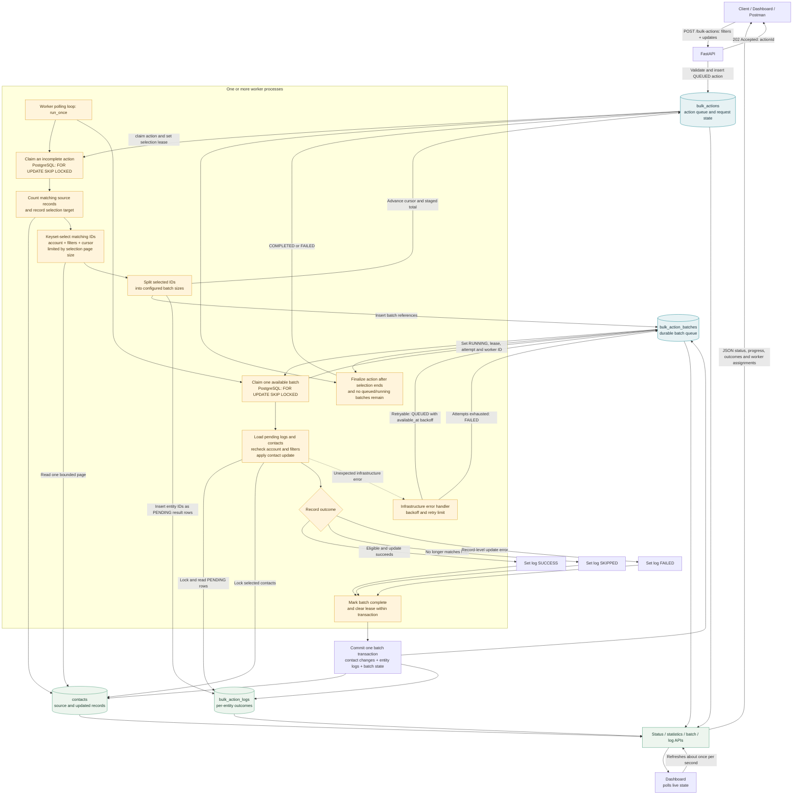

# Current Data Flow

This diagram reflects the implementation in this project. The durable queue is stored in the database; Redis is not used. The action-selection/orchestration role is currently part of each worker process rather than a separate service.

## Processing notes

- PostgreSQL is the supported database for multiple competing workers. Each worker claims a different available action or batch row with `SKIP LOCKED`; no worker is permanently assigned a batch.
- PostgreSQL is required for both local and scaled runs. SQLite is not supported because it cannot provide the row-lock coordination used by competing workers.
- The queue contains durable action and batch references. Entity IDs are staged in `bulk_action_logs` and are not sent as a large queue payload.
- Selection is keyset-paged and bounded by `SELECTION_PAGE_SIZE`; each page is split into batches no larger than `BATCH_SIZE`.
- A batch’s record updates and result logs are committed in one transaction. If that transaction rolls back, the batch remains retryable and its uncommitted record outcomes are retried together.
- In-progress record counts are inferred from pending logs attached to running batches. Individual log rows do not currently transition to a persisted `PROCESSING` status.
- Record-level `FAILED` outcomes do not fail the whole action when the batch completes. The action becomes `FAILED` when infrastructure retries exhaust a batch; otherwise it completes after all selection and queued work finish.
- A separate orchestrator service is not implemented. Every worker loop can claim an action page and can claim a batch; the orchestration role is logical, not a separate process.
